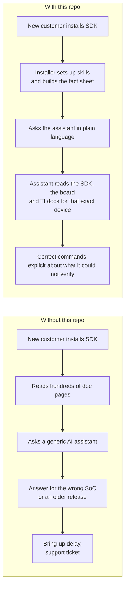
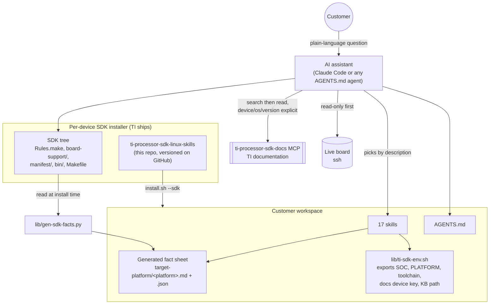
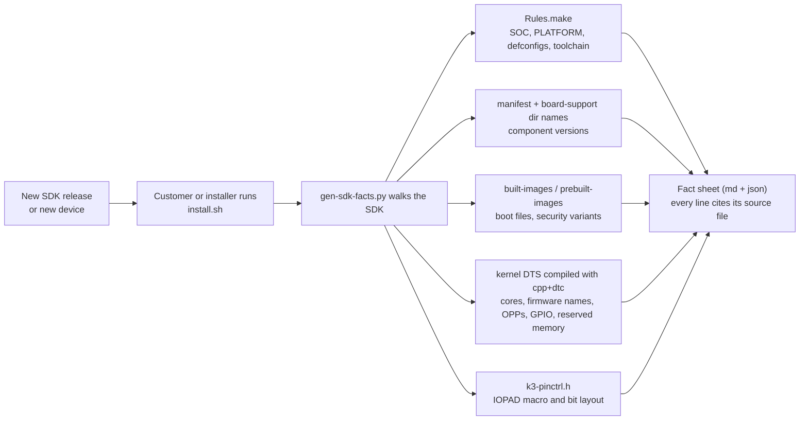
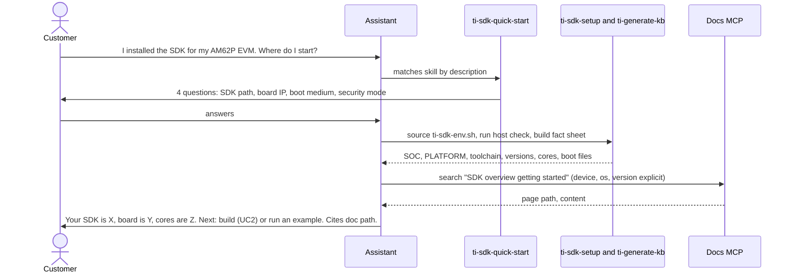
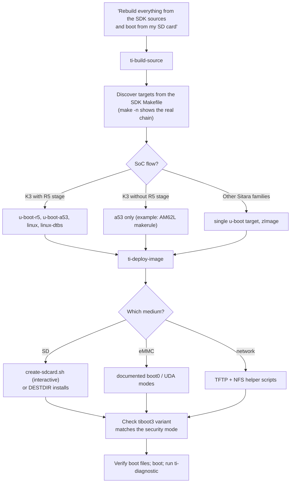
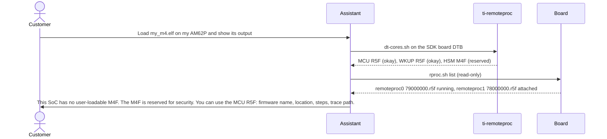
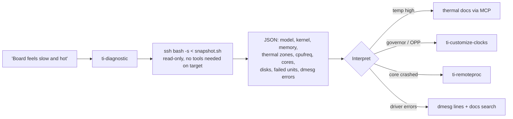
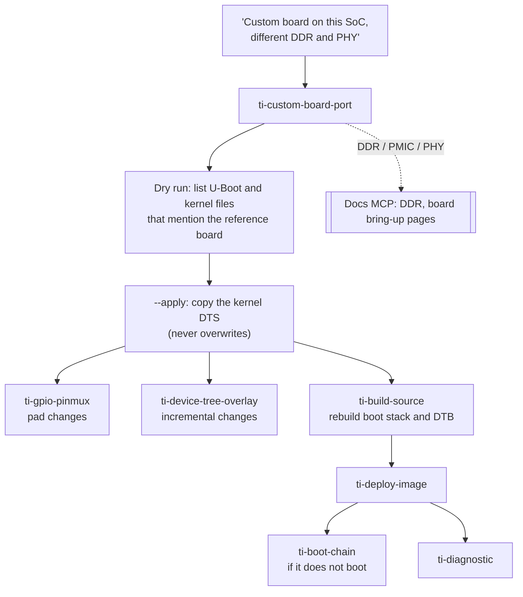
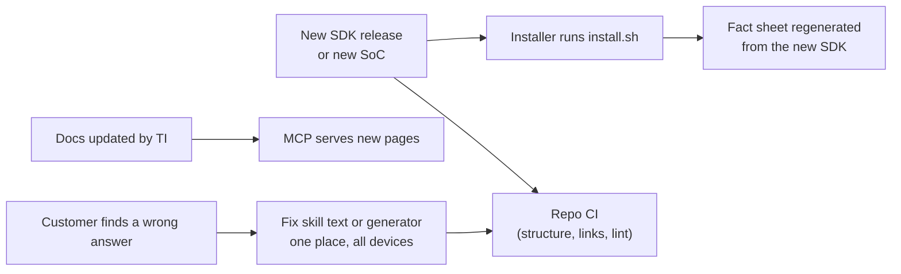

# Agentic TI Processor SDK Linux: overview, use cases and demo guide

Audience: engineering management, field and applications teams, SDK owners.
Status of this document: describes what exists in this repository today and what has and has not
been tested (section 9). Nothing here is aspirational unless marked "roadmap".

---

## 1. Summary

A customer installs a TI Processor SDK Linux and asks an AI coding assistant questions in plain
language ("my board is slow and hot", "load my firmware on the M4", "rebuild U-Boot and put it on
an SD card"). The assistant answers from three sources of truth, never from memory:

1. the customer's own installed SDK (`Rules.make`, kernel device trees, boot images, manifest),
2. the customer's live board over ssh (read-only checks first),
3. TI's published documentation, searched on demand through the `ti-processor-sdk-docs` MCP server.

This repository packages that behavior as **17 skills** plus a **generator** that builds a
per-device fact sheet out of the installed SDK. Because device facts are generated from the SDK
that the customer actually has, one repository serves every Sitara/K3 device and every release,
and nobody has to hand-maintain per-device tables.

What the customer gets: faster onboarding, correct answers for their exact SoC and SDK release,
and an assistant that says "this SoC has no PRU" instead of inventing a procedure.

What TI gets: one maintained repository shipped inside every device installer, guardrails against
hallucinated hardware facts, and a feedback loop (the skills report where docs and SDK disagree).

---

## 2. The problem it solves



Real examples of wrong generic answers that this design prevents (all found and corrected while
building this repo):

| A generic assistant says | Reality on the AM62P SDK 12.02 | How the repo prevents it |
|---|---|---|
| "Load your M4F firmware with remoteproc" | AM62P has no user M4F; its M4F is reserved for security | `ti-remoteproc` reads the device tree first and gates on the cores that exist |
| "Use the `AM625_IOPAD` macro" | Each SoC has its own macro (`AM62PX_IOPAD`, `AM64X_IOPAD`, ...) | `ti-gpio-pinmux` reads the macro from the SDK header |
| "Run the PRU code on PRU0" | AM62P has no PRU-ICSS | `ti-pru` has a gate that stops on SoCs without PRU |
| "Use `k3-respart-tool --config x.yaml`" | The tool is SysConfig-based, no such CLI | `ti-resource-partition` describes only what the SDK ships |
| "tiboot3-gp is the default" | Default depends on the SDK and the security mode | `ti-boot-chain` lists the variants found in the installed SDK |

---

## 3. How it works

### 3.1 Architecture



### 3.2 Three rules the assistant follows (from `AGENTS.md`)

1. Device values come from the SDK, never from memory.
2. Procedures come from TI docs through the MCP, with device, OS and version passed explicitly.
   If a doc page and the SDK disagree, the SDK wins and both are reported.
3. If something cannot be verified, say so. Ask before any destructive action (flash, partition,
   overwrite boot files).

### 3.3 Why device facts are generated, not written



Maintenance consequence: when TI ships a new SDK or a new SoC, there is **no per-device file to
edit** in this repository. The generator reads whatever that SDK contains. Facts the generator
cannot find are written as "not found", never guessed. A hand-written file is allowed only for
facts that cannot be derived, and each needs evidence (`context/known-quirks.md`, currently two entries).

### 3.4 What is inside

| Area | Contents |
|---|---|
| `skills/` | 17 task skills (table in section 4) |
| `lib/ti-sdk-env.sh` | Reads `Rules.make`; exports SOC, PLATFORM, ARCH, U-Boot machines, DTB prefix, toolchain, docs device key, KB paths. Finds the SDK from env vars, the current directory, or the profile |
| `lib/gen-sdk-facts.py` | Builds the fact sheet (stdlib Python, needs `cpp` and `dtc`) |
| `context/` | Shared reference: workflow, SDK layout, MCP usage rules, known quirks |
| `install.sh` | Copies the above into `<workspace>/.claude`, writes the profile, builds the fact sheet, optionally registers the docs MCP (`--mcp <url>` / `--mcp-mode auto\|docker\|stdio`) |
| `.github/scripts/check_repo.py` | CI: skill structure, links, no stale references, lint against hardcoded SoC names |
| `mcp/` | The documentation MCP server (separate deployment) |

---

## 4. The skills

```mermaid
flowchart LR
    QS["ti-sdk-quick-start<br/>entry and router"] --> P1
    subgraph P1["1 Setup"]
        S1[ti-sdk-setup]
        S2[ti-generate-kb]
    end
    P1 --> P2
    subgraph P2["2 Customize"]
        C1[ti-gpio-pinmux]
        C2[ti-device-tree-overlay]
        C3[ti-custom-board-port]
        C4[ti-customize-clocks]
        C5[ti-resource-partition]
        C6[ti-yocto-custom-dt]
    end
    P2 --> P3
    subgraph P3["3 Build"]
        B1[ti-build-source]
        B2[ti-yocto-build]
        B3[ti-kernel-module]
    end
    P3 --> P4
    subgraph P4["4 Deploy and run"]
        D1[ti-deploy-image]
        D2[ti-boot-chain]
        D3[ti-remoteproc]
        D4[ti-pru]
    end
    P4 --> P5
    subgraph P5["5 Validate and debug"]
        V1[ti-diagnostic]
    end
```



| Skill | The customer asks | What the assistant does |
|---|---|---|
| `ti-sdk-quick-start` | "I'm new, where do I start?" | Asks four questions (SDK path, board IP, boot medium, security mode), routes to the right skill |
| `ti-sdk-setup` | "Is my host ready?" | Runs the SDK host check, loads environment from `Rules.make`, checks toolchains and MCP |
| `ti-generate-kb` | "What does my SoC have?" | Builds the per-device fact sheet from the SDK |
| `ti-build-source` | "Rebuild kernel and U-Boot" | Discovers the SDK Makefile targets for this SoC and runs them; knows single-stage vs R5+A53 flows |
| `ti-deploy-image` | "Put it on an SD card / eMMC / network boot" | `create-sdcard.sh`, `DESTDIR` installs, eMMC and TFTP/NFS paths; asks before destructive steps |
| `ti-boot-chain` | "No console output", "which tiboot3?" | Boot flow, security modes (GP, HS-FS, HS-SE), verifies boot artifacts |
| `ti-gpio-pinmux` | "What is this pad? Toggle a GPIO" | Decodes pad registers with the SDK header, lists GPIO chips, safe libgpiod usage |
| `ti-device-tree-overlay` | "Enable PWM without editing the main DT" | Builds an overlay, test-applies it to the SDK DTB, shows how U-Boot loads it |
| `ti-custom-board-port` | "We designed our own board" | Copies the reference board DTS (dry run by default), lists what else references the reference board |
| `ti-remoteproc` | "Run my firmware on the other core" | Lists the cores that exist, their firmware names and state, loads and reads traces; refuses reserved or boot-loaded cores |
| `ti-pru` | "Run PRU code" | Stops on SoCs with no PRU; otherwise the documented load flow |
| `ti-kernel-module` | "Build my driver for the board" | Out-of-tree build against the SDK kernel, warns on vermagic mismatch with the running board |
| `ti-customize-clocks` | "Limit to 800 MHz, save idle power" | cpufreq governors, OPP table from the DTS, LPM latency constraints |
| `ti-resource-partition` | "Give my R5 firmware exclusive DMA channels" | Locates the SysConfig-based tool and its outputs, explains where the QoS header enters U-Boot |
| `ti-yocto-build` | "I need a Yocto image, not the prebuilt rootfs" | `oe-layersetup` flow and `bitbake` targets with host requirements |
| `ti-yocto-custom-dt` | "Get my device tree into the Yocto image" | Where the machine config defines device trees; marks unverified steps as such |
| `ti-diagnostic` | "Board is slow, hot, or behaving oddly" | One read-only JSON snapshot: identity, kernel, memory, thermal, cpufreq, cores, disks, failed units, dmesg errors |

---

## 5. Use cases, end to end

Each use case shows the customer's words, what the assistant does, and the evidence from the AM62P
EVM (SDK 12.02.00.01.01, board at the lab IP) unless stated otherwise. Section 9 states which were
run end to end and which were verified at script and document level.

### UC1. New customer onboarding ("where do I start?")



Value: the customer never has to learn the directory layout or the Makefile conventions first.

### UC2. Rebuild kernel, device trees and U-Boot, boot from SD



Evidence: `make -n u-boot-r5` and `make -n linux` print the real command chain for this SDK. The
assistant tells the user what differs on other SDKs (the AM335x SDK has no `u-boot-r5` target and
builds `zImage`). Destructive steps (SD card write, eMMC write) are never run silently.
Known SDK behavior reported to the user: `make linux` re-applies the default kernel config each time
(a hand-edited `.config` is lost) and also rebuilds U-Boot.

### UC3. "What is this pin and how do I toggle a GPIO?"

Customer pastes `AM62PX_IOPAD(0x01e0, PIN_INPUT_PULLUP, 0)`.

1. `ti-gpio-pinmux` greps the board DTS for the offset: the trailing comment reads `(B25) I2C0_SCL`.
2. It reads the live pad register through debugfs: `00064000`, decoded by the SDK-header-driven
   decoder to `PIN_INPUT_PULLUP`, matching the DTS.
3. It lists GPIO chips on the board with libgpiod: four chips (two I2C expanders and
   `600000.gpio` with 92 lines, `601000.gpio` with 52 lines) and shows named lines.
4. It shows the safe way to toggle a line and warns to check for pad conflicts first.

Value: the customer gets a correct answer for their SoC macro and their board, not a pin table from
a different part.

### UC4. Add PWM on the expansion header without touching the main device tree


Evidence: the SDK's own `ehrpwm` overlay builds and applies cleanly to the SDK-built board DTB; a
deliberately broken label fails with `FDT_ERR_NOTFOUND`. The skill also reports that this board has
no runtime configfs overlay interface, so overlays are applied at boot by U-Boot.

### UC5. "Load my M4F firmware" (a trap the assistant must catch)



Real output from the lab run:

```
NODE                           COMPATIBLE       FIRMWARE-NAME          STATUS
r5fss@79000000/r5f@79000000    ti,am62-r5f      am62p-mcu-r5f0_0-fw    okay
r5fss@78000000/r5f@78000000    ti,am62-r5f      am62-wkup-r5f0_0-fw    okay
bus@f0000/remoteproc@43c00000  ti,hsm-m4fss     am62p-hsm-m4f-fw       reserved
```

On an AM62x, the same question works as asked: the device tree shows an M4F with
`am62-mcu-m4f0_0-fw`, and the same skill walks the load steps. The skill refuses to touch cores
that Linux only attached to (the device-manager core) and cores in a crashed state are stopped first.

### UC6. "Run PRU code" (device-dependent answer)

| Device (from its DTS) | `ti-pru` gate result |
|---|---|
| AM62P, AM62A, AM62D, AM62L | Stops: no PRU nodes, tells the user this SoC has no PRU |
| AM62x | Proceeds: 2 PRU cores (`am62x-pru0-fw`, `am62x-pru1-fw`) |
| AM64x | Proceeds: PRU, RTU and TX_PRU cores on two ICSSG instances; warns when an Ethernet driver node owns the same cores |

Verified on the real AM62P SDK, the real AM62x SDK, and the other SoCs' device trees from the AM62P
SDK kernel tree. Caveat: the PRU compiler (`clpru`) is not in the SDK; the skill says where to get
it and no PRU build was run in our lab.

### UC7. "My board is slow and hot"



Real output from the lab board (trimmed): model `Texas Instruments AM62P5 SK`, three thermal zones
`main0/1/2-thermal` around 52 C, four CPUs at 1.4 GHz with governor `performance`, remoteproc0
`running`, remoteproc1 `attached`, no failed units. The script works without `jq` or `python3` on
the target and produces valid JSON on a different board type (tested on an x86 host as well).

### UC8. "No console output after I flashed the SD card"

`ti-boot-chain` and `ti-deploy-image`:

1. Confirm the `tiboot3` variant on the card matches the silicon security mode (GP, HS-FS, HS-SE);
   the SDK ships several variants and the default differs per SDK.
2. Compare the boot partition files against the SDK images (`verify-boot-artifacts.sh`). On the lab
   board all three boot files on the SD card differed from the SDK build, which the tool surfaces.
3. Check the SD speed-mode and bus-width workarounds the docs list for `mmc init failed`.
4. Cite the documentation pages (boot flow, security, migration guide) from the MCP.

Honest limitation: the skill gives a checklist drawn from the docs. A guided decision tree for
"no output" does not exist yet (roadmap, section 10).

### UC9. "Limit the CPU to 800 MHz and cut idle power"

`ti-customize-clocks` reads the real OPP table from the SDK DTS for the customer's SoC (OPP counts and
`opp-supported-hw` masks differ per SoC: AM62P offers seven OPPs on the lab board), shows the
sysfs commands (governor, `scaling_max_freq`, `scaling_setspeed`), how to disable an OPP via an overlay
node, and the LPM resume-latency constraint documented by TI. On AM64x, which has no CPU OPP table,
the skill says cpufreq steps do not apply. The skill flags a documented unit slip (the docs example
uses Hz where sysfs expects kHz).

### UC10. "Give my R5 firmware exclusive resources"

`ti-resource-partition` locates the K3 Resource Partitioning tool in the SDK (SysConfig based),
lists its real inputs and outputs (`.syscfg`, `*_qos.h`), and explains the verified link into the
build: the QoS header is consumed by U-Boot's R5 stage when the QoS option is enabled. It states
what is not documented (how the allocation reaches the device manager firmware) instead of guessing.
It also says what to do when the SDK has no tool.

### UC11. "We designed a custom board" (bring-up)



Skills that exist for this flow are verified at script level. DDR configuration and PMIC changes are
pointed to TI documentation; the repository does not contain DDR tuning procedures.

### UC12. "I need a Yocto image for my product"

`ti-yocto-build` gives the documented flow: clone `oe-layersetup`, run the layer setup with the
SDK's config file, source the environment, then `MACHINE=<machine> bitbake -k tisdk-default-image`.
It checks host requirements (disk, swap, packages) with a script, and says which parts cannot be
tested here. `ti-yocto-custom-dt` explains that a device tree that builds in the SDK flow is not
automatically in the Yocto image, because the machine configuration controls it.

### UC13. "Build my kernel module"

`ti-kernel-module` builds an out-of-tree module against the SDK kernel with the SDK toolchain
(tested: a sample module builds as aarch64), refuses an inconsistent environment, and warns when the
module's vermagic will not match the kernel actually running on the board. The lab board's kernel
string differs from the SDK tree's, which the skill detects.

### UC14. Same questions, different SoC

The same skills run unchanged on other devices because every device fact is read from the SDK.

| SoC | Source of the test | Cores found | Pinmux macro found |
|---|---|---|---|
| AM62P | Real SDK 12.02 + live board | MCU R5F, WKUP R5F, HSM M4F (reserved) | `AM62PX_IOPAD` |
| AM62x | Real SDK 12.01 | M4F, WKUP R5F, 2 PRU | `AM62X_IOPAD` |
| AM64x | Device tree from the AM62P SDK kernel | M4F, 4 R5F, PRU, RTU, TX_PRU on 2 ICSSG | `AM64X_IOPAD` |
| AM62A | Device tree from the AM62P SDK kernel | R5F x2 (plus a C7x DSP in the generator's JSON) | `AM62AX_IOPAD` |
| AM62D | Device tree from the AM62P SDK kernel | R5F x2 (plus a C7x DSP) | `AM62DX_IOPAD` |
| AM62L | Device tree from the AM62P SDK kernel | none | `AM62LX_IOPAD` |

Be precise when presenting: only AM62P (with hardware) and AM62x (SDK only) were tested against
real SDKs. The other four were tested through their device trees; their SDK installers were not
available.

### UC15. Documentation questions ("tiboot3 hs-fs vs hs?", "what is the K3 boot flow?")

The assistant searches the MCP with explicit device and version, reads the page, cites the path,
and applies it to the customer's SDK. When the MCP lags the SDK (docs list 12.01, the lab SDK is
12.02), the skill says so and prefers the SDK's files. Example mismatches the skills already report:
docs name a `gp` tiboot3 that the 12.02 AM62P SDK does not ship; the docs' wake-up R5F memory pool
size differs from the SDK device tree.

---

## 6. Guardrails (why a manager can trust it)

| Risk | Control |
|---|---|
| Hallucinated hardware facts | Facts come from SDK, board and docs only; unverifiable statements removed; CI lint blocks hardcoded SoC names in skill instructions |
| Wrong device or release | Device key and version are explicit on every docs call; SDK wins over docs; mismatches are reported |
| Destructive actions | Flash, partition and overwrite steps need confirmation; SDK scripts that are interactive are handed to the user; board checks are read-only first |
| Silent scope creep across devices | A core class (M4F, PRU, DSP) is used only if the device tree has it |
| Stale knowledge | Fact sheet regenerated from the installed SDK; docs fetched live |
| Maintenance burden | No per-device hand-written tables; CI checks structure, links and stale references |

---

## 7. Maintenance model



What a contributor must do to add a skill is in `CONTRIBUTING.md`; CI enforces name equals
directory, a 200-line limit, the required sections, a link to the MCP usage rules, and referenced
scripts only.

---

## 8. Demo script (about 12 minutes)

Setup (before the room): `./install.sh --workspace ~/demo --sdk <sdk> --mcp <mcp-url>`; open the
agent in `~/demo`; confirm board reachable; docs MCP registered.

| Min | Say | Show |
|---|---|---|
| 0-1 | "Customer installed the SDK, nothing else." | `ls ~/demo/.claude`, the generated fact sheet header |
| 1-3 | UC1: "I'm new, where do I start?" | Four questions, environment summary, cited doc path |
| 3-5 | UC5: "Load my M4F firmware on this board." | The assistant corrects the premise from the device tree, offers the R5F |
| 5-6 | UC6: "Run PRU code." | Stops cleanly; contrast with an AM62x workspace if available |
| 6-8 | UC7: "The board feels slow and hot." | Live JSON snapshot, interpretation |
| 8-10 | UC3 or UC4: pin lookup, or PWM overlay build and test-apply | Real decode / overlay output |
| 10-11 | UC2: "Rebuild and put on SD." | Discovered targets, confirmation gate before any write |
| 11-12 | Close | The table in section 9, and the roadmap |

Questions management will ask, with the honest answers:

- *Does it work on other Sitara parts?* Yes by construction, because facts come from each SDK. Tested
  on AM62P (hardware), AM62x (SDK), and four other SoCs through device trees only.
- *What stops it from making things up?* It cannot answer device facts without reading the SDK or
  board, and the CI lint blocks hardcoded SoC facts. It also states what it could not verify.
- *Who maintains device data?* Nobody by hand; it is regenerated from each SDK.
- *Does the customer need the internet or a TI server?* Only for the docs MCP. Without it the skills
  fall back to the SDK and say that docs were not consulted. TI-hosted MCP hosting is pending.

---

## 9. What has been validated, and what has not

Be explicit in front of management. "Verified" means run against the real SDK, board or docs.

| Area | Status |
|---|---|
| Static checks (structure, links, SoC-name lint, shell and Python syntax) | Pass, 17 skills, 0 warnings |
| Fact sheet generator | Run on the AM62P SDK (matches the live board: model, both R5F cores and firmware, seven OPPs), the real AM62x SDK, AM335x and TDA54 SDKs (no crash); four more SoCs through their device trees |
| Installer | Tested into a clean workspace with and without an SDK, with MCP registration |
| `ti-diagnostic` | Run on the live board over ssh; valid JSON; also on an x86 host |
| `ti-remoteproc`, `ti-pru` gating | Run against six SoC device trees and the live board; write paths tested on a fake sysfs tree, not on hardware |
| `ti-gpio-pinmux` | Decoder run on all 206 live pad registers; GPIO list and read on the board; GPIO write only against stubs |
| `ti-device-tree-overlay` | SDK overlay built and test-applied; not booted on the board |
| `ti-build-source`, `ti-deploy-image` | Targets confirmed with `make -n`; scripts dry-run (eMMC script ran with `--dry-run` over ssh). No full build, no SD or eMMC write executed |
| `ti-kernel-module` | Sample module built; not loaded on the board |
| `ti-yocto-build`, `ti-yocto-custom-dt` | Commands match TI docs and a local layer clone; no bitbake run; `.bbappend` syntax marked unverified |
| `ti-customize-clocks`, `ti-resource-partition`, `ti-boot-chain` | Facts checked against the SDK DTS, U-Boot source and docs; no change applied to a board |
| **Fresh-agent natural-language trials** | **Partially done.** Five independent simulator agents were started and then stopped when the model policy changed to on-prem only. UC3, UC4, UC5, UC6 and the UC2 dry run were then executed by the session assistant following the skills against the real SDK and board. UC1, UC8 to UC13 and UC15 were verified at skill, script and documentation level but have not been run as independent customer sessions. |

Recommended next validation before wider release: run the 15 scenarios above as independent
sessions on the intended on-prem model, record pass/fail per scenario, and keep the transcripts as
regression tests.

---

## 10. Roadmap and known gaps

Original plan items that are **not** implemented in this repository today:

| Gap | Note |
|---|---|
| Guided interview with structured prompts, "prefill" contract, multiple saved target profiles | Quick-start asks four plain questions; one profile file |
| Commit batching and message-preview gate, overlay tracker | Not carried over from the Jetson design |
| SDK download and extract automation, "derive carrier" and image promotion skills | Not built |
| Investigator sub-agents (boot, M-core, build) | Removed because earlier content was unverified; can be rebuilt on the verified skills |
| Boot-failure decision tree | Only a checklist from the docs today |
| Debian, Buildroot, Android, Edge AI variants | Only the Linux SDK flow is covered, though the MCP serves other variants |
| Non-K3 families (AM335x, AM437x, AM57x) | Generator and a few skills degrade gracefully; no dedicated coverage |
| TI-hosted docs MCP endpoint | Pending; customers use Docker or stdio today |
| Reproducible evals and regression transcripts | None checked in; earlier benchmark claims were removed as fabricated |
| Real-hardware tests of write paths | GPIO write, firmware load, eMMC write, overlay boot |

Suggested order: (1) run the scenario suite on the target model and commit the results, (2) boot-failure
tree, (3) SDK download and extract skill, (4) investigator agents, (5) other Linux variants.

---

## 11. Quick reference for customers

```bash
# one-time, packaged or standalone
./install.sh --workspace ~/my-ws --sdk ~/ti-processor-sdk-linux-<platform>-<version> --mcp <mcp-url>
cd ~/my-ws && claude

# things to say
"I'm new to this SDK, where do I start?"
"Which cores does my SoC have and how do I load firmware on one?"
"Rebuild the kernel and U-Boot and put them on an SD card."
"What does pad 0x1e0 do? Show me the GPIO lines."
"Add PWM on the header with a device tree overlay."
"My board is slow and hot, check it."
"Limit the CPU to 800 MHz."
"I have a custom board based on this EVM."
"I need a Yocto image."
```

Regenerate the device fact sheet after changing SDK sources:
`python3 .claude/lib/gen-sdk-facts.py --sdk-root <sdk> --out-dir .claude/target-platform`
